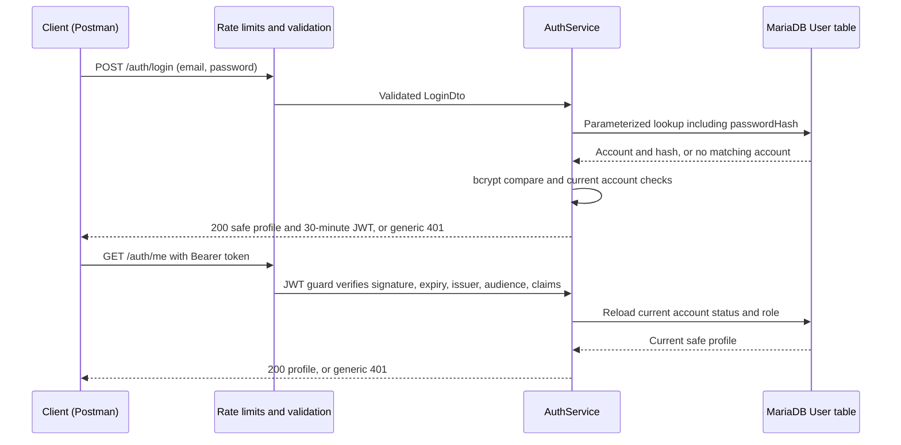

# Authentication and security — Step 9

Implemented from Laboratory Activity 06 and the final-project authentication requirements.
This phase provides two production endpoints only. The scaffold Hello World endpoint
was removed. No academic CRUD controller, frontend, or schema migration was added.

## Endpoints

Base URL for local development: `http://127.0.0.1:3000/api/v1`.

| Method | Path | Access | Success | Failure codes |
|---|---|---|---|---|
| POST | /auth/login | Public, rate limited | 200 | 400 invalid request; 401 authentication failed; 429 limit reached |
| GET | /auth/me | Valid Bearer JWT and currently active account | 200 | 401 missing/invalid/expired token or unavailable account; 429 limit reached |

Role-restricted future endpoints use the reusable Roles decorator and guard. A valid
user without an allowed current role receives 403. No extra production endpoint was
added just to demonstrate 403; a controller registered only in automated tests verifies it.
Unexpected internal failures return sanitized 500 responses without SQL or stack traces.

## Authentication flow



Invalid password, nonexistent email, and Inactive account use exactly the same 401
body. Unknown accounts still perform bcrypt verification against a process-local dummy
hash at cost 12 to reduce obvious timing differences; this does not promise perfectly
identical response timing. Existing demo hashes are verified, never regenerated.

Email is trimmed and lowercased. Passwords are not trimmed or normalized. Login accepts
nonempty strings up to 72 UTF-8 bytes, matching bcrypt's input limit. No new password
policy is retroactively imposed on existing accounts.

## Request and response examples

The following are placeholders, not actual credentials or usable tokens. Use a fictional
account from the ignored local `.env.demo` file in Postman; never export its password/token.

```http
POST /api/v1/auth/login
Content-Type: application/json

{
  "email": "student.one@sgms.example.test",
  "password": "<local-demo-password>"
}
```

```json
{
  "accessToken": "<signed-access-token>",
  "tokenType": "Bearer",
  "expiresIn": 1800,
  "user": {
    "userId": 1,
    "firstName": "Demo",
    "lastName": "One",
    "email": "student.one@sgms.example.test",
    "role": "Student",
    "accountStatus": "Active",
    "createdAt": "<UTC creation timestamp>"
  }
}
```

IDs and timestamps are illustrative and must be taken from the actual response.

```http
GET /api/v1/auth/me
Authorization: Bearer <signed-access-token>
```

The 200 profile response is the same safe `user` object shown above, without the token
wrapper. Only userId, firstName, lastName, email, role, accountStatus, createdAt are returned.

```json
{ "statusCode": 400, "message": "Invalid request" }
```

```json
{ "statusCode": 401, "message": "Authentication failed" }
```

```json
{ "statusCode": 403, "message": "Forbidden" }
```

```json
{ "statusCode": 429, "message": "Too many requests" }
```

## JWT and configuration

- HS256 signature; a cryptographically random 64-byte secret encoded as 128 hex characters.
- Secret stored only in ignored `backend/.env`; no fallback/default signing secret.
- Fixed 30-minute lifetime: `JWT_EXPIRES_IN=30m`, response `expiresIn=1800` seconds.
- Signed claims: string `sub` (user ID), role, iat, exp, issuer `sgms`, audience `sgms-api`.
  No email, password, password hash, or database information is included in the token.
- Verification restricts algorithm, issuer, audience, expiry, subject format, and role claims.
- Current role/status is reloaded on every protected request; token role is not trusted
  for current permissions. A previously issued token reflects role changes immediately
  on the next request. Deactivation makes subsequent protected requests return 401.
- Tokens are accepted only in the Authorization Bearer header, not URLs or query parameters.
- Tokens remain bearer credentials: client-side deletion does not revoke a stolen token.
  No refresh-token/logout endpoint or denylist is added in this scoped prototype.
- Reactivating an account can allow an unexpired old token again. Secret rotation invalidates
  all existing tokens; deliberate rotation is outside the automatic configuration command.

For a newly provisioned local configuration, after Apache protection is verified:

```powershell
npm.cmd run auth:configure-secret
```

This fills a blank JWT_SECRET without printing it and preserves an existing strong
secret. It refuses to overwrite an unexpected existing value. Never commit `.env`,
`.env.demo`, database credentials, token exports, or screenshots showing secrets.

## Reusable components

- `JwtAuthGuard` protects defined routes globally by default; only `@Public()` bypasses it.
- `@CurrentUser()` supplies the current, explicitly projected safe account.
- `@Roles('Admin', 'Department Head')` declares allowed roles using the existing role type.
- `RolesGuard` runs after authentication and evaluates current database role.
- `AuthModule` exports the authentication service and reusable guards.
- `configureApp()` applies `/api/v1`, shared validation, no-store responses, and disables
  Express's identifying header and trust proxy. Main and HTTP tests use the same setup.
- Global ValidationPipe uses whitelist, forbidNonWhitelisted, transform, and disabled
  implicit primitive conversion. Unexpected fields are rejected rather than silently accepted.
- The global exception filter returns fixed public messages, does not log sensitive errors,
  and never echoes request bodies, URLs, SQL, tokens, secrets, or stack traces.
- Startup emits a generic failure message; error-level framework logs are disabled to avoid
  exposing internal configuration. This intentionally limits diagnostics in this prototype.

Role authorization does not replace ownership checks. The upcoming Subject/Enrollment/
Grade services must still verify faculty assignments and student ownership. No academic
mutation or audit logging workflow is introduced by these read/login endpoints.

## Rate limits

- Login: five requests per 60 seconds per client IP. Successful, failed, and DTO-invalid
  login requests count. The sixth receives 429 while blocked.
- General API: 100 requests per 60 seconds per client IP across defined route handlers.
- Rate limiting runs before authentication and validation to count rejected requests too.
- Client identity is Express's direct peer IP. Trust proxy is disabled; X-Forwarded-For
  cannot be used to evade limits. IPv6 uses individual addresses (128-bit prefix).
- Default throttler memory storage is suitable for this one-process local prototype;
  counters reset on restart. Multiple workers would need shared storage.
- Clients behind the same NAT share a public IP and therefore a limit. A future reverse
  proxy must be explicitly reviewed for trusted proxy/IP handling before deployment.

## Local HTTP limitation

The backend binds to `127.0.0.1:3000` by default. Plain HTTP is a local-development
exception to Lab 06's HTTPS design. It does not encrypt passwords or tokens in transit.
Do not expose this HTTP backend to a LAN or the public internet. HTTPS and reviewed
proxy configuration are required before remote deployment. Apache's SGMS directory
denial protects source files; it does not provide TLS for the separate NestJS listener.

## Automated verification and isolation

```powershell
npm.cmd run build
npm.cmd test -- --runInBand
npm.cmd run test:e2e -- --runInBand
npm.cmd run test:database
```

HTTP tests exercise the actual Nest controllers, bcrypt, JWT, guards, validation, throttling,
exception filter, and MariaDB repository. They read the four seeded active roles without
changing their passwords. A random temporary account exists only inside an uncommitted
transaction; the test overrides the User repository to use that transaction. Deactivation
and role-change tests modify only this temporary account. Final cleanup rolls back the
transaction, verifies the account is absent, and checks the demo credential file is unchanged.
AUTO_INCREMENT gaps from rolled-back test inserts are expected; IDs are never reset.

Test-only RBAC/error fixture routes are registered by the test module, never production.
Each HTTP test starts a fresh application instance for isolated rate-limit counters and
closes it afterward. Tests use temporary HTTP listeners rather than reserving port 3000.
No migrations, schema resets, or updates to seeded users are run by auth tests.

Coverage includes all four roles, generic login failures, input rejection (including UTF-8
byte limits), missing/malformed/wrong-signature/expired JWTs, invalid claims, missing users,
safe profile retrieval, role-based 403, status and role changes, login/general 429, spoofed
forwarding headers, confidential-value exclusion, and sanitized internal failures.

The existing database verification remains applicable. The Windows Application Control
limitation on oxlint remains unchanged; no policy bypass or forced upgrade was attempted.

Verified results for this phase: build passed; 2 JWT configuration tests passed;
31 HTTP authentication/security tests passed; all 47 existing database checks passed.
The approved schema, seeded account passwords, and reference PDF hashes are unchanged.

## References

- Local `references/lab act#6.pdf`, authentication flow and security design.
- Local `references/final project.pdf`, authentication and security requirements.
- [NestJS authentication](https://docs.nestjs.com/security/authentication).
- [NestJS authorization](https://docs.nestjs.com/security/authorization).
- [NestJS rate limiting](https://docs.nestjs.com/security/rate-limiting).
