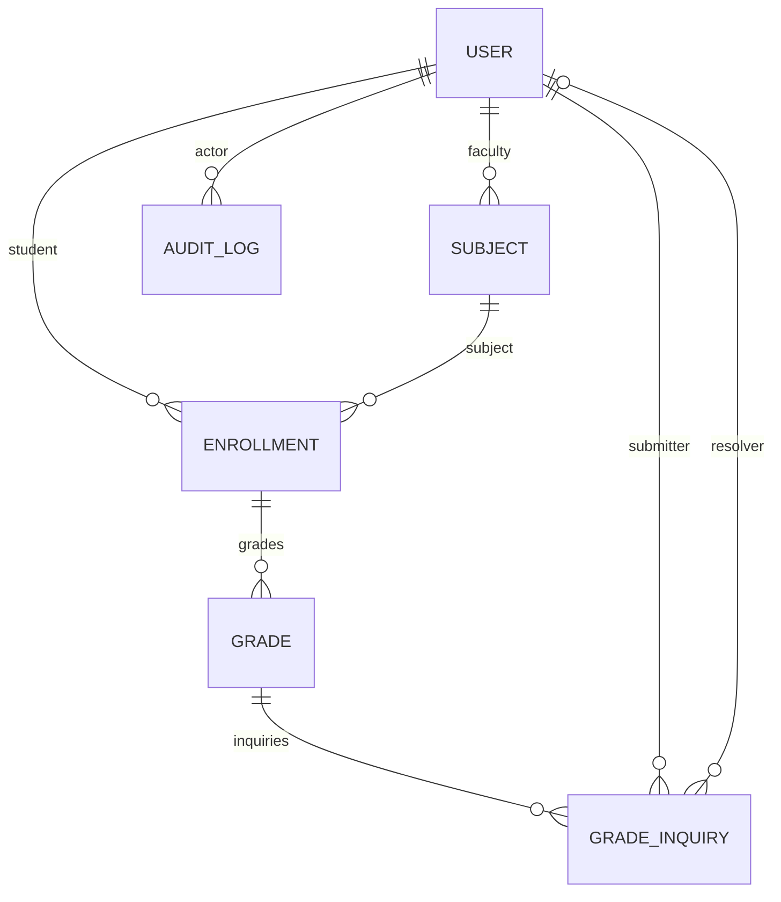

# SGMS database design and implementation

## Scope and evidence

Implemented for ITEC 116 using Laboratory Activity 04 (five handwritten pages),
the final-project requirements, the Phase 1 corrections, and the approved domain rules.
MariaDB 10.4.32 is the approved MySQL-compatible database substitution.
This is a single-department prototype with one current faculty assignment per Subject.
Authentication and role guards are now implemented in Step 9; see
[authentication security](authentication-security.md). Subjects CRUD is implemented in
[Step 10](subjects-api.md), and Enrollments CRUD in [Step 11](enrollments-api.md).
Grades, Grade Inquiries, User management APIs, and frontend work remain deferred.

## Connection and operational safety

- Host: `127.0.0.1`; port: `3306`; database: `student_grade_monitoring_db`.
- TypeORM type: `mariadb`; driver: `mysql2`.
- Engine: InnoDB; character set/collation: `utf8mb4` / `utf8mb4_unicode_ci`.
- The runtime account `sgms_app@127.0.0.1` has SELECT, INSERT, UPDATE, DELETE only,
  scoped to the SGMS database. It has no schema administration privileges.
- The explicit migration account `sgms_migrator@127.0.0.1` additionally has CREATE,
  ALTER, INDEX, REFERENCES, also scoped to SGMS. Neither account has DROP or GRANT OPTION.
- Credentials are independently generated with 32 cryptographically random bytes each.
  They are stored only in ignored `backend/.env`. Root credentials are not stored.
- Provisioning refuses an existing SGMS database, account name, or `.env` file.
  It never resets databases or changes existing users. Provisioning DDL is not atomic;
  errors require inspection and are never followed by automatic destructive cleanup.
- Provisioning verifies HTTP 403 for SGMS before writing credentials. Verification also
  probes actual `.env` and `.env.demo` files. Root `.htaccess` supplies the Apache rule.
- `synchronize`, `dropSchema`, and automatic startup migrations are disabled.
- Configuration refuses a different engine, host, port, database, or unexpected account.
- SQL logging is disabled in the application. Driver errors in seed/provision scripts
  are sanitized because SQL parameters may contain credentials or hashes.
- The SGMS mysql2 pool initializes EACH new session with strict SQL mode and UTC.
  No global SQL mode, time zone, Apache configuration, or XAMPP configuration is changed.
  This prevents permissive XAMPP coercion of invalid NOT NULL writes and date values.

## Tables and Lab 04 attribute mapping

TypeScript uses camelCase and SQL uses snake_case. All primary keys are INT,
NOT NULL, AUTO_INCREMENT. Foreign keys use the same INT type.
All fields are NOT NULL unless explicitly marked nullable below.

| Entity / SQL table | TypeScript attribute → SQL column and type |
|---|---|
| User / users | userId → user_id INT PK; firstName → first_name VARCHAR(50); lastName → last_name VARCHAR(50); email → email VARCHAR(100) UNIQUE; passwordHash → password_hash VARCHAR(255); role → role VARCHAR(20); accountStatus → account_status VARCHAR(20); createdAt → created_at DATETIME |
| Subject / subjects | subjectId → subject_id INT PK; subjectCode → subject_code VARCHAR(20) UNIQUE; subjectName → subject_name VARCHAR(100); units → units INT; facultyId → faculty_id INT FK |
| Enrollment / enrollments | enrollmentId → enrollment_id INT PK; studentId → student_id INT FK; subjectId → subject_id INT FK; semester → semester VARCHAR(20); schoolYear → school_year VARCHAR(9); dateEnrolled → date_enrolled DATE; status → status VARCHAR(20) |
| Grade / grades | gradeId → grade_id INT PK; enrollmentId → enrollment_id INT FK; gradeType → grade_type VARCHAR(20); score → score DECIMAL(5,2); remarks → remarks VARCHAR(30), nullable; dateRecorded → date_recorded DATETIME |
| GradeInquiry / grade_inquiries | inquiryId → inquiry_id INT PK; gradeId → grade_id INT FK; studentId → student_id INT FK; message → message TEXT; status → status VARCHAR(20); dateSubmitted → date_submitted DATETIME; resolvedBy → resolved_by INT FK, nullable; resolutionNote → resolution_note TEXT, nullable; dateResolved → date_resolved DATETIME, nullable |
| AuditLog / audit_logs | auditId → audit_id INT PK; userId → user_id INT FK; action → action VARCHAR(100); tableAffected → table_affected VARCHAR(50); recordId → record_id INT, nullable; actionTimestamp → action_timestamp DATETIME |

The technical `sgms_migrations` table is TypeORM's migration history, not a seventh
domain entity. It records the migration timestamp and class name.

## Corrected relationships



Each child FK is many-to-one; entities expose corresponding one-to-many collections.
All eight foreign keys use ON DELETE RESTRICT and ON UPDATE RESTRICT.
Students and Subjects are connected through Enrollment, which holds academic term data.
The Grade's student is derived through Enrollment; there is no redundant direct User–Grade FK.
AuditLog.recordId is contextual metadata paired with tableAffected, not a foreign key
to one arbitrary domain table.

## Constraints, indexes, and defaults

- Unique email and subject code (case-insensitive under the chosen collation).
- Unique `(student_id, subject_id, semester, school_year)` enrollment.
- Unique `(enrollment_id, grade_type)` grade.
- CHECK constraints for the four roles; Active/Inactive accounts; positive units;
  Enrolled/Dropped/Completed enrollments; Midterm/Final grades; score 0–100;
  Pending/Resolved inquiries; nonempty semester and inquiry message.
- School year CHECK requires `YYYY-YYYY` and consecutive years.
- Pending inquiry: resolver, resolution note, resolution date must all be NULL.
- Resolved inquiry: all three fields required, nonblank note, resolution time not before submission.
- Defaults: Active account, Enrolled enrollment, Pending inquiry; creation/recording/audit
  DATETIME columns use CURRENT_TIMESTAMP at second precision.
- Indexed subject faculty, enrollment subject, inquiry grade/student/resolver/status,
  audit `(user_id, action_timestamp)`, and audit `(table_affected, record_id)`.
  Composite unique indexes also cover their leading student/enrollment foreign keys.
- TypeORM excludes passwordHash from ordinary entity selections. This is defense in depth;
  future response DTOs must explicitly whitelist public fields.

## Corrections and clarifications versus Lab 04

1. Preserved every final, non-crossed-out attribute and its substantive data type/length.
   SQL naming is normalized to plural snake_case; TS names remain camelCase.
2. Removed the unsupported direct User–Grade ERD line. Added the Student–Enrollment
   relationship and distinguished inquiry submitter from optional resolver.
3. Corrected ResolvedBy NOT NULL to nullable while Pending. ResolutionNote and DateResolved
   were already nullable; state-dependent constraints now keep all three consistent.
4. INT display widths such as INT(11) and INT(2) are not value limits. Used INT and explicit
   positive-unit validation rather than interpreting display widths as digit constraints.
5. Added the approved composite uniqueness rules and explicit enum-like VARCHAR checks,
   school-year checks, defaults, and indexes omitted or left unspecified in the handwritten dictionary.
6. Defaults and database CHECK expressions are maintained by explicit migration SQL.
   Do not rely on TypeORM synchronization to create or maintain MariaDB CHECK constraints.
7. DECIMAL(5,2) preserves Lab 04. MariaDB rounds excess fractional input before CHECK evaluation;
   it cannot distinguish 92.501 from its rounded stored value. `assertGradeScore` rejects
   excess precision before writes and is tested; future grade DTOs/services must apply it.
   Never claim that the database alone rejects all inputs with more than two places.
8. An FK to User verifies existence, not the referenced user's role. Faculty/student/resolver
   role checks, inquiry ownership, faculty assignment checks, and restrictions on reassigning
   graded enrollments remain required in the later service/API phase. No triggers or
   authentication modules are introduced in this database-only phase. Seed consistency is verified.
9. Single current faculty per Subject and no department table are deliberate prototype limits;
   historical faculty offerings and multiple departments are outside this schema's scope.

## Migrations

Migration: `InitialSgmsSchema1795564800000`.

It creates all six domain tables in dependency order. MariaDB DDL implicitly commits,
so migration transaction mode is `none` and the migration declares `transaction = false`.
It refuses a different target database. Destructive `down()` is intentionally disabled;
future schema corrections require approved forward migrations. No database reset command exists.

From `backend`, after configuration is securely provisioned:

```powershell
npm.cmd run build
npm.cmd run migration:show
npm.cmd run migration:run
```

Migration run completed successfully and appears executed in TypeORM's history.
Read-only schema comparison confirms entity metadata matches the migrated schema.
Do not edit an applied migration to change an existing database; add a forward migration.

## Controlled fictional seed

```powershell
$env:SGMS_CONFIRM_DEMO_SEED='student_grade_monitoring_db'
npm.cmd run seed:demo
```

The seed requires explicit confirmation, the exact SGMS configuration, and empty domain
tables. A database advisory lock prevents concurrent seeds. All seed writes are in one
transaction. Re-running the recognized demo dataset is a no-op; unrelated/nonempty data
or an existing demo credential file is never overwritten.

| Table | Rows | Demo coverage |
|---|---:|---|
| users | 6 | Two Students, two Faculty, one Admin, one Department Head; one inactive Student |
| subjects | 2 | Separate faculty assignments |
| enrollments | 2 | Enrolled and Completed statuses |
| grades | 3 | Midterm and Final; nullable remarks |
| grade_inquiries | 2 | Pending and Resolved; matching student/grade ownership |
| audit_logs | 1 | DEMO_SEED accountability marker |

All emails use the fictional `sgms.example.test` domain. Each user receives an independent
random 32-character password, hashed with bcrypt cost 12. No passwords or hashes are printed.
Local demo credentials are in ignored `backend/.env.demo` for later presentation/testing.
Neither environment file belongs in Git, screenshots, SQL exports, or shared documents.

## Verification

```powershell
npm.cmd run build
npm.cmd run test:database
npm.cmd test -- --runInBand
```

Database verification checks account scope, strict/UTC sessions, Apache 403 probes,
migration state, table types/nullability, all eight foreign keys, entity schema consistency,
seed counts, all password hashes, passwordHash default exclusion, and ORM relationship traversal.
Negative SQL probes test unique keys, required fields, CHECK constraints, orphan foreign
keys, and restricted parent deletes. Positive score endpoints and temporary Subject CRUD
are tested. All data probes are rolled back; no test database reset or committed data rewrite occurs.
MariaDB AUTO_INCREMENT counters can advance during failed or rolled-back inserts; gaps are normal.
Nest's database module is initialized and closed without starting an HTTP server.

The verification command is a controlled local integration check against this exact
fictional seed, not a general test runner for arbitrary academic data.

The scaffold's oxlint native binding is blocked by Windows Application Control, including
outside the sandbox. This limits lint verification; do not disable OS policy or force
dependency upgrades to bypass it. Build and database checks run independently.

## Sources

- Local `references/Labact#4.pdf`, all five pages (excluded from Git for privacy).
- Local `references/final project.pdf`, database and backend requirements.
- [NestJS TypeORM integration](https://docs.nestjs.com/data/typeorm).
- Installed TypeORM 1.1.3 definitions/source for MariaDB options and migration behavior.
